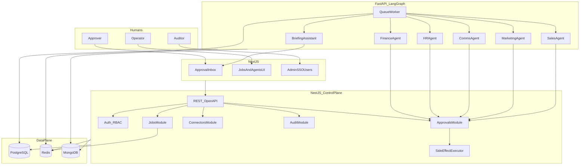
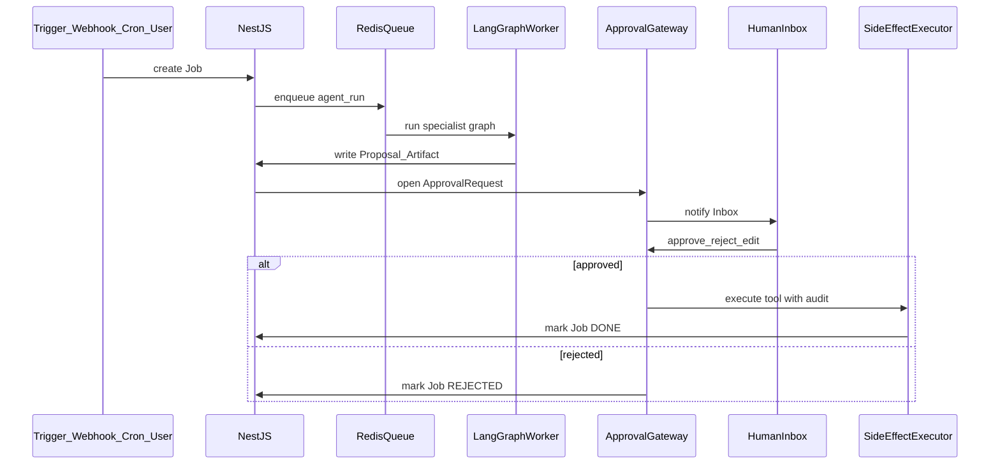

# Architecture

## Stack (locked)

| Layer | Choice | Role | Rejected |
|---|---|---|---|
| Web UI | Next.js App Router + TypeScript | Approval Inbox, agent consoles, admin | Unrelated SPA frameworks |
| Control plane | NestJS + TypeScript | Auth, RBAC, jobs, approvals, connectors, audit, OpenAPI | Fastify beside Nest; GraphQL v1 |
| Agent runtime | FastAPI + Python + LangGraph | Specialist graphs, tools, HITL interrupts | LLM loops inside Nest |
| System of record | PostgreSQL 16 | Users, roles, jobs, approvals, connectors, audit | Approvals only in Mongo |
| Queue / realtime | Redis 7 | Job queue, locks, pub/sub | Poll-only without Redis |
| Artifact store | MongoDB 7 | Large unstructured outputs, traces | Huge blobs as Postgres rows |
| Local / early install | Docker Compose | Dev and small private installs | Ad-hoc manual services |
| Enterprise install | Helm + Terraform | Repeatable customer VPC deploy | Undocumented one-offs |
| LLM | Provider API via secrets; private endpoint later | Reasoning | Hard-coded vendor in app code |

## Why hybrid TypeScript + Python

- TypeScript owns the enterprise product surface: UI, auth, permissions, OpenAPI, admin.
- Python + LangGraph owns durable agent graphs, tool calling, and human interrupts.
- NestJS never runs LLM loops. FastAPI never owns SSO or the approval ledger.

## Trust boundaries

```text
Public users → Next.js → NestJS (HTTPS)
NestJS → FastAPI (private network; mTLS or service token). FastAPI is not public.
Connectors / side effects after approval → NestJS SideEffectExecutor (audit consistency)
```

## System diagram



## Component responsibilities

| Component | Owns | Must not own |
|---|---|---|
| Next.js | UX, session bridge, live inbox client | Business invariants, secret storage |
| NestJS | AuthZ, job state machine, approvals, audit, connector metadata, side effects | Long-running LLM reasoning |
| FastAPI / LangGraph | Agent graphs, DEMO/LIVE tools, proposal drafting | Final permission for irreversible actions |
| PostgreSQL | Canonical transactional state | Large free-form research dumps |
| Redis | Queues, locks, notifications | Source of truth for approvals |
| MongoDB | Artifacts and traces | Passwords / final approval status |

## Job lifecycle



## Shared agent graph pattern

```text
observe → reason → tool_call → draft_proposal → emit_approval → END
```

At `emit_approval`, the worker writes the proposal, opens an approval via NestJS, and **stops**. Nest owns human resume and side-effect execution.
