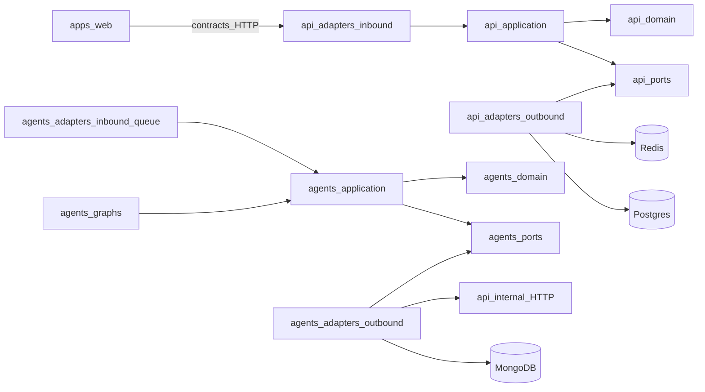

# SOLID and Hexagonal Rules

Industry-level modular architecture: bounded contexts, ports & adapters, and CI-enforced import boundaries.

## SOLID mapping

| Principle | Enforcement |
|---|---|
| **S**ingle Responsibility | One bounded context folder = one reason to change (Approvals never contains Stripe HTTP) |
| **O**pen/Closed | New connector or agent = new adapter file; domain use-cases stay closed |
| **L**iskov Substitution | DEMO and LIVE adapters implement the same port contract |
| **I**nterface Segregation | Small ports (`JobRepositoryPort`, `ApprovalDecisionPort`) — no god `IDatabase` |
| **D**ependency Inversion | Domain/application depend on ports; adapters implement ports; wiring only in composition / Nest modules |

## Dependency rule (non-negotiable)

```text
domain            → (nothing inward)
application       → domain + ports
adapters/inbound  → application
adapters/outbound → ports + external tech
composition       → wires adapters to ports
```

### Forbidden imports

- `domain/*` must not import Nest, Prisma, Redis, Mongo, LangGraph, or Next
- `application/*` must not import HTTP decorators or ORM models
- Agent `graphs/*` must not import DEMO/LIVE tool internals — only ports
- `apps/web` must not implement job/approval state machines

## NestJS bounded contexts

| Module | Owns | Example ports |
|---|---|---|
| `IdentityModule` | Users, roles, login/OIDC | `UserRepositoryPort`, `TokenIssuerPort` |
| `JobsModule` | Job state machine | `JobRepositoryPort`, `JobQueuePort` |
| `ApprovalsModule` | Decision packets, SLA | `ApprovalRepositoryPort`, `ApprovalNotifierPort` |
| `AgentsCatalogModule` | Agent definitions | `AgentDefinitionRepositoryPort` |
| `ConnectorsModule` | Provider registry | `SecretStorePort`, `ConnectorHealthPort` |
| `SideEffectsModule` | Post-approve execution | `SideEffectExecutorPort`, per-tool ports |
| `AuditModule` | Append-only ledger | `AuditWriterPort`, `AuditReaderPort` |
| `ArtifactsModule` | Artifact metadata API | `ArtifactStorePort` |
| `HealthModule` | Liveness / readiness | Infrastructure probes only |

## Python agent runtime areas

| Area | Responsibility |
|---|---|
| `domain/` | Proposal, RiskLevel, AgentKey — pure Python |
| `application/` | RunAgent, EmitApproval, BuildDecisionPacket |
| `ports/` | Ledger, Mailbox, WebSearch, ControlPlane, ArtifactStore |
| `adapters/tools/demo/` | Fixture-backed tools |
| `adapters/tools/live/` | Real APIs |
| `adapters/control_plane/` | Nest internal HTTP client |
| `adapters/inbound/queue/` | Redis worker |
| `graphs/` | LangGraph orchestration only |
| `composition/` | DI wiring for DEMO \| LIVE |

## Import-lint gates

- TypeScript: ESLint `no-restricted-imports` per module boundary
- Python: `import-linter` contracts (domain independence; graphs cannot import live tools directly)
- CI fails on boundary violations

## Dependency flow



See also: [STRUCTURE.md](./STRUCTURE.md).
